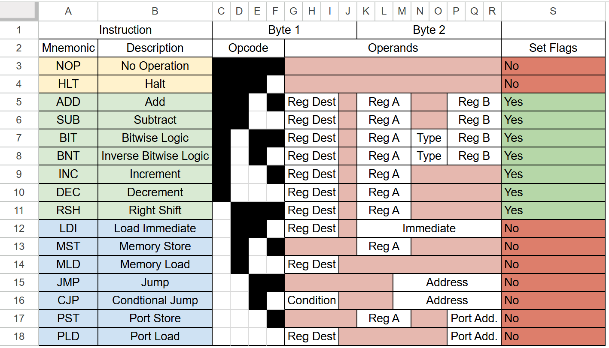

# Instruction Set Architecture

## Registers
The Minecraft computer has 7 general purpose registers in addition to r0, which serves as a zero register. 
## Notes
**Set Flags**\
Instructions with Yes in Set Flags means that flag registers are written to after that instruction is executed. These are used by the `CJP` instrcution to determine whether to jump to a certain address.

**BIT TYPE**\
00 - OR\
01 - AND\
10 - XOR

**BNT TYPE**\
00 - NOR\
01 - NAND\
10 - XNOR

**MST**\
Uses 5LSBs of R7 for the address

**MLD**\
Uses 5LSBs of R7 for the address

**CJP Condition**\
000 - Negative\
001 - Not Negative\
010 - Zero\
011 - Not Zero\
100 - Overflow\
101 - No Overflow\
110 - Carry Out\
111- No Carry
# Minecraft Computer Specs
- 0.3125 Hz CPU (Can be Overclocked)
- 128 bytes of Program Memory (ROM)
- 16 bytes of Data Memory (RAM)