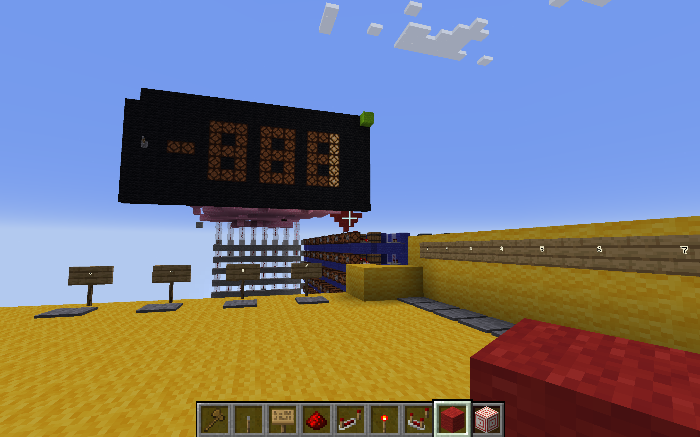
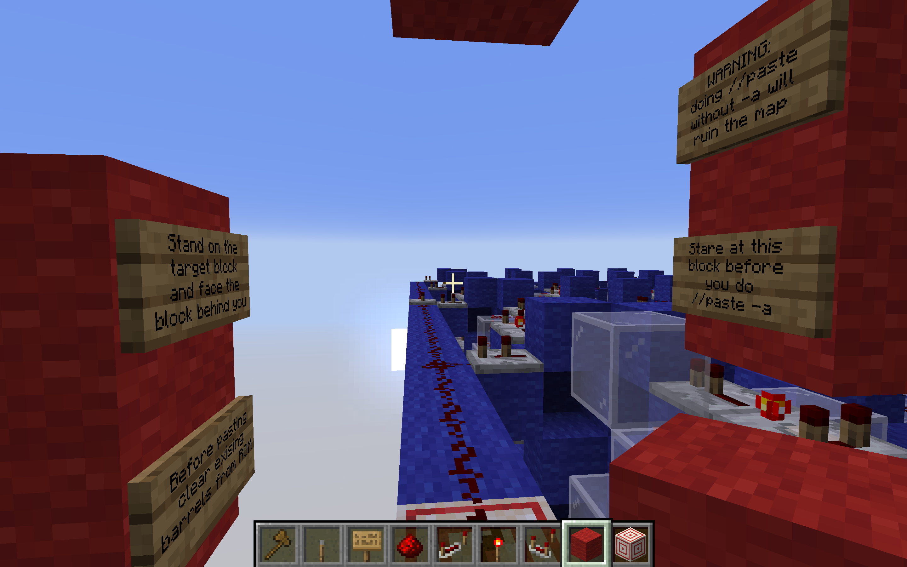
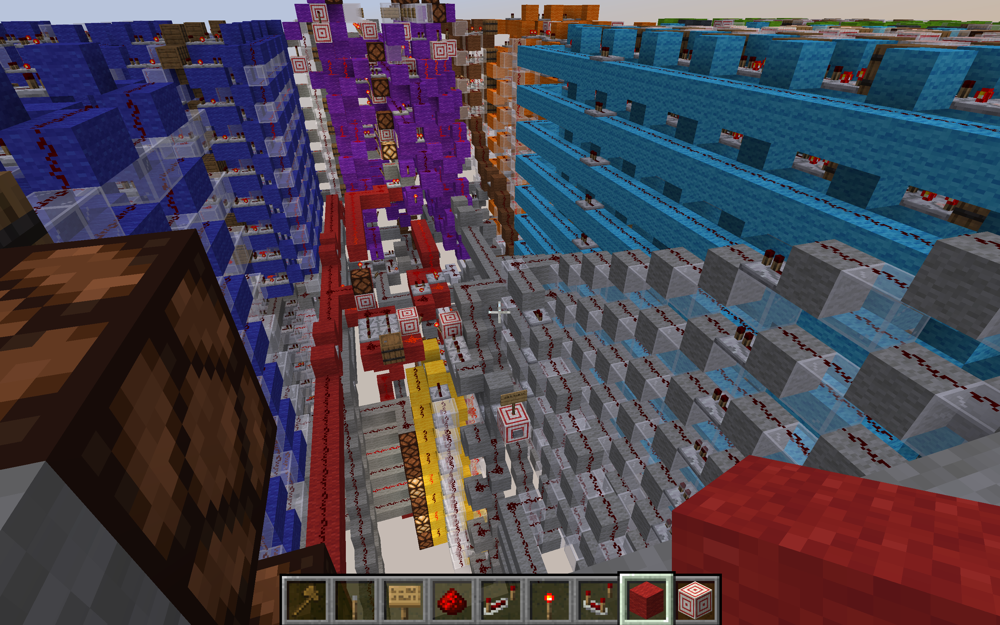
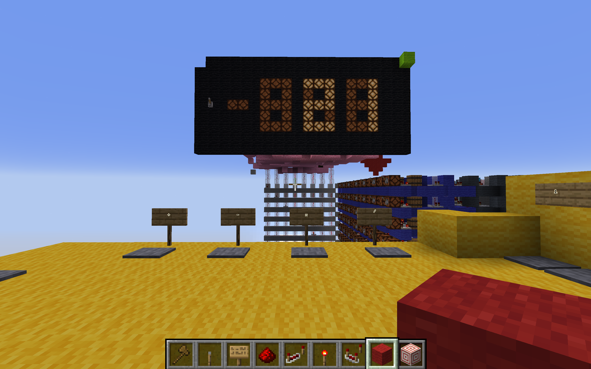

# Minecraft Setup
## Requirements
- Minecraft Java Edition
- A mod loader, I personally use [Fabric](https://fabricmc.net/)
- [WorldEdit](https://www.curseforge.com/minecraft/mc-mods/worldedit)
- [Carpet](https://www.curseforge.com/minecraft/mc-mods/carpet/files/7318937) is also highly recommended as it is used to speed up the game (further discussed in later section).
## Creating a schematic file
To run your own program put the assembly file in `programs/` and make sure it has the `.as` file extension. For this example we'll use the `fibsequence` program. This program prints numbers in the fibonacci sequence to the number display.

To create a schematic run the following command and specify the filepath to WorlEdit's schematics directory. The path should be something like this.

**Windows**
```bash
python main.py fibsequence -s "C:\Users\paulm\AppData\Roaming\.minecraft\config\worldedit\schematics"
```
**WSL**
```bash
python main.py fibsequence -s "/mnt/c/Users/paulm/AppData/Roaming/.minecraft/config/worldedit/schematics"
```
## Download
Download the Minecraft world from [here](https://www.planetminecraft.com/project/8-bit-computer-7109316/).
## Loading programs into ROM
All program memory is stored in ROM and is pasted in as a WorldEdit schematic of barrels.
### 1. Open the world
This is where you'll be when you first open the world.

### 2. Go to the red arrow
Below the number display you should be able to see a red arrow in the distance, head to it. This is where you should be once you're there.

### 3. Paste the program
Press t to open game chat and paste the following command to verify the schematic is there.

**Check that the schematic exists**
```Plaintext
//schem list
```
**Select the schematic you want to paste into the world**
```Plaintext
//schem load fibsequence
```
**Clear any barrels already loaded into ROM**

Before pasting clear any barrels in ROM by running these commands
```Plaintext
//pos1 -30,-25,57
//pos2 -58,-40,8
//replace barrel air
```
Follow the instructions on the signs and run the command below

**WARNING:**

`//paste` can break the map, only use `//paste -a`

Face the block indictaed by the signs before pasting anything
```Plaintext
//paste -a
```
### 4. Start the computer
Press the button on the target block with the sign shown in this screenshot.

### 5. Speed up the game
This step requires that you have the carpet mod it is not neccessary but highly recommended. If you are on a newer version of Minecraft you may not need carpet as setting the game's tickrate is a built-in feature on newer versions of Minecraft.

**Set game speed to maximum (normal game speed is 20)**
```Plaintext
/tick rate 500
```
**That's it, watch your program run!**
